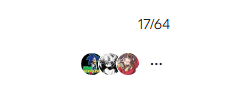

# DICEFEST 2026 ? Prediksi Energi Bangunan dengan Ensemble

Pipeline V21 untuk memprediksi gas, listrik, EUI gas, rasio bangunan bersih, dan adopsi pemanas listrik pada kompetisi DICE FEST 2026.

## Hasil

| Evaluasi | Nilai |
|---|---:|
| Public score historis | **0,25167** |
| CV OOF, lima fold subzone | **0,269111308193** |
| Seed | 42 |

Public score berasal dari hasil submission yang dicatat selama kompetisi. Gambar menunjukkan peringkat 17/64; konteks public/private pada gambar tidak ditentukan. CV adopsi dihitung tanpa lookup; evaluasi tahap blend belum fully nested.

## Pipeline

1. Memuat prediksi backbone S28 dari Dani, termasuk koreksi iklim.
2. Merekonsiliasi gas dan EUI melalui estimasi silang gas/luas dan EUI ? luas.
3. Melatih RealMLP untuk EUI serta listrik per luas dengan fitur bangunan, wilayah, rasio, dan target encoding zona.
4. Menggabungkan 75% acuan dengan 25% RealMLP pada kolom energi masing-masing.
5. Mempertahankan clean dari rumus eksak dan lookup adopsi untuk subzone test yang dikenal.

Notebook utama: [v21-new.ipynb](v21-new.ipynb). Notebook ini memakai cache prediksi S28 dan melatih anggota neural; bukan training ulang seluruh backbone S28.

## Dataset

Data kompetisi: [DICE FEST 2026 Machine Learning ? Data](https://www.kaggle.com/competitions/dicefest-2026-machine-learning/data).

File yang digunakan adalah `train.csv` (429.303 baris), `test.csv` (183.987 baris), dan `sample_submission.csv`. CSV diambil langsung dari Kaggle.

Dua artefak acuan S28 disertakan pada [artifacts/s28](artifacts/s28): `prediksi_oof_test.npz` dan `prediksi_meta.json`. Keduanya merupakan prediksi dan metadata backbone dari Dani, bukan CSV mentah atau model pretrained eksternal.

## Menjalankan di Kaggle

1. Unggah `v21-new.ipynb` sebagai Kaggle Notebook.
2. Tambahkan dataset kompetisi melalui **Add Input**.
3. Unggah kedua file pada `artifacts/s28` sebagai satu Kaggle Dataset, lalu tambahkan sebagai Input.
4. Aktifkan GPU dan Internet, lalu **Run All**. Notebook memakai PyTabKit 1.7.3; dependensi screening TabM dipasang oleh notebook bila belum tersedia.
5. Hasil utama tersimpan pada folder output V21, dengan nama `submission_v21_selected_locked_recipe.csv` apabila resep lolos konfirmasi.

Hasil run baru dapat berbeda dari skor historis. Sumber notebook dipertahankan sebagaimana run yang tersimpan.
